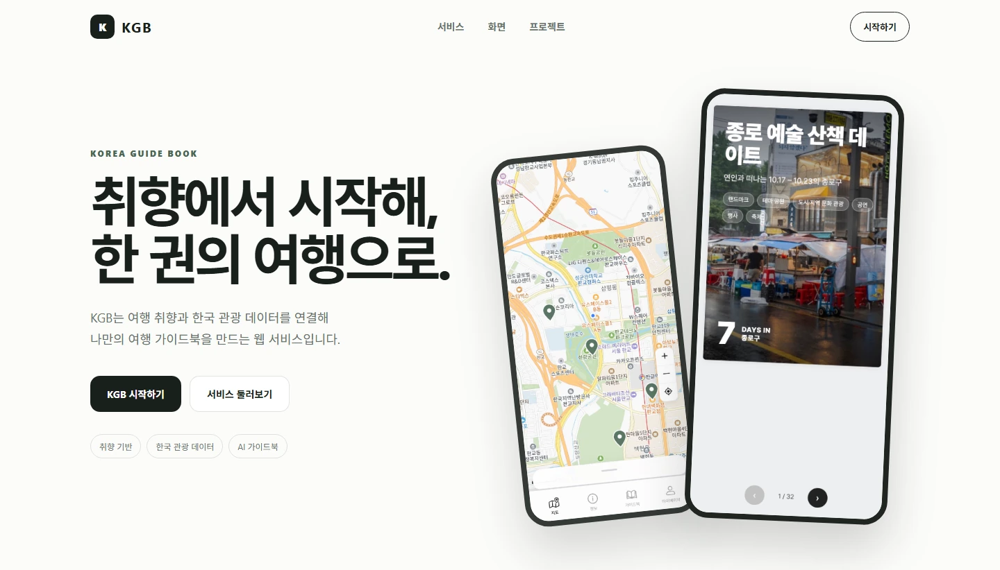
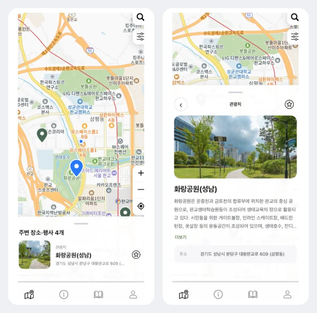
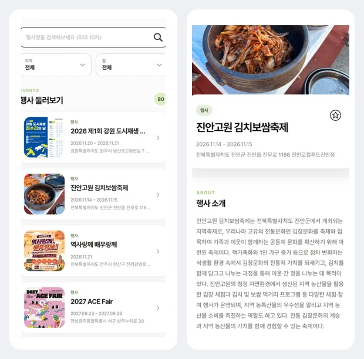
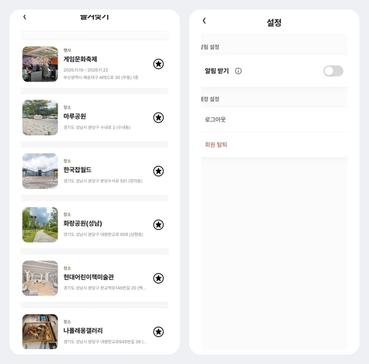
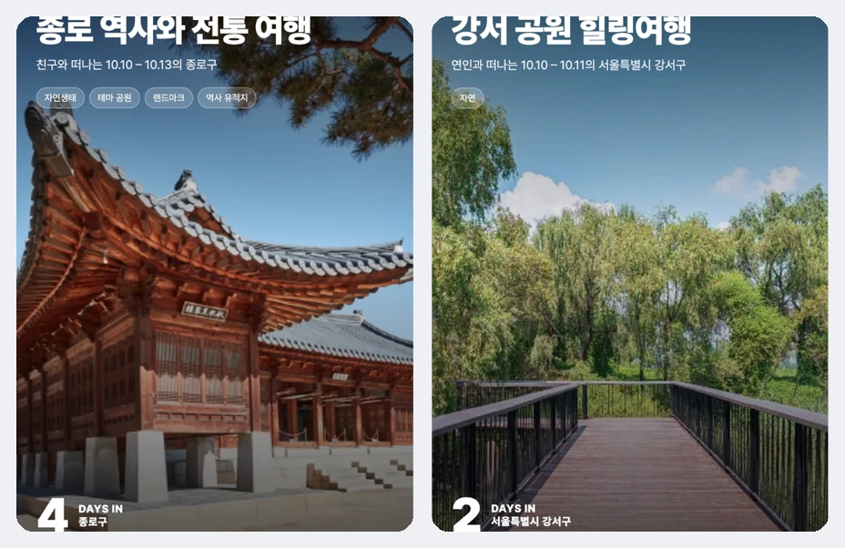

# KGB | Korea Guide Book

**취향에서 시작해, 한 권의 여행으로.**

KGB는 국내 관광지와 행사를 찾아보고, 여행 일정과 취향에 맞는 **AI 여행 가이드북**을 만드는 서비스입니다. 여행을 준비할 때는 지도에서 가고 싶은 곳을 찾고, 여행 중에는 가이드북에서 일정과 장소 정보를 확인할 수 있습니다.

카카오테크 부트캠프 4기 10팀 · **8월–11월**

[서비스 소개](https://kguidebook.site/about) · [서비스 시작하기](https://kguidebook.site) · [팀원](#팀원) · [저장소 활용](#저장소-활용) · [로컬 실행](#로컬에서-실행하기)

[](https://kguidebook.site/about)

## 주요 기능

| 지도 탐색 | AI 가이드북 생성 |
| --- | --- |
|  |  |
| 관광지와 행사를 지도에서 확인하고 관심 장소를 저장합니다. | 여행지·기간·동행·취향에 맞는 날짜별 일정을 만듭니다. |

| 행사 정보 | 즐겨찾기와 알림 |
| --- | --- |
|  |  |
| 지역과 월로 행사를 찾고, 기간·장소·이용 정보를 확인합니다. | 저장한 장소와 행사를 모아 보고 알림을 설정합니다. |

### 생성된 가이드북



## 팀원

| AI | 풀스택 | 클라우드·인프라 |
| --- | --- | --- |
| [Sian](https://github.com/sian056) | [Justin](https://github.com/dwkim0512) | [Ayden](https://github.com/taejun-J) |
| [Orbit](https://github.com/KIMDONGWOOK12) | [Jun](https://github.com/Yonduss) | [Mia](https://github.com/sim16065) |

## 저장소 활용

이 저장소에는 KGB 백엔드 API가 있습니다. 화면까지 띄우려면 프런트엔드를, 가이드북 생성까지 테스트하려면 AI 서버를 함께 실행합니다. 배포 구성을 살펴보려면 인프라 저장소를 참고하세요.

| 저장소 | 역할 |
| --- | --- |
| [백엔드](https://github.com/100-hours-a-week/KTB4-10th-BE) | Spring Boot API, 카카오 로그인, 관광 데이터·가이드북 생성 관리 |
| [프런트엔드](https://github.com/100-hours-a-week/KTB4-10th-FE) | React·Vite 기반 지도, 가이드북, 알림 화면 |
| [AI 서버](https://github.com/100-hours-a-week/KTB4-10th-AI) | 여행 일정·가이드북 HTML 생성, 진행·결과 콜백 |
| [인프라](https://github.com/100-hours-a-week/KTB4-10th-Cloud) | 배포 환경과 GitOps 구성 |

## 로컬에서 실행하기

**준비물**은 Java 21, Node.js 24, MySQL 8.4와 클라이언트, Docker Compose입니다. 백엔드와 프런트엔드 저장소를 각각 받아 두세요.

### 1. 백엔드와 관광 데이터

빈 MySQL 스키마 `kgb_local`과 그 스키마에 권한이 있는 계정을 준비합니다. 백엔드에서 [`.env.example`](./.env.example)을 `.env`로 복사하고 `DB_URL`, `DB_USERNAME`, `DB_PASSWORD`, `AI_CALLBACK_TOKEN`을 설정합니다. 로컬 체험에서는 `TOUR_API_SCHEDULER_ENABLED=false`로 둡니다.

```bash
docker compose -f compose.redis.yml up -d
set -a
source ./.env
set +a
SPRING_PROFILES_ACTIVE=local ./gradlew bootRun
```

백엔드는 [8080](http://localhost:8080), 헬스 체크는 [8081의 `/actuator/health`](http://localhost:8081/actuator/health)입니다. Flyway가 테이블을 만든 뒤 백엔드를 종료하고, 아래 명령으로 덤프를 복원한 다음 다시 실행합니다.

```bash
./scripts/database/restore-tourism-data.sh
```

덤프에 지역·관광 콘텐츠·행사 데이터가 들어 있어 **TourAPI 키 없이** 초기 데이터를 채울 수 있습니다. [초기 데이터 적재 안내](./docs/TourAPI%20초기%20데이터%20적재.md)

### 2. 프런트엔드

프런트엔드에서 `.env.example`을 `.env.local`로 복사하고, 지도를 보려면 `VITE_KAKAO_MAP_APP_KEY`를 설정합니다. `VITE_API_BASE_URL`을 비워 두면 Vite 프록시가 백엔드 `8080`으로 요청을 전달합니다.

```bash
npm ci
npm run dev
```

[localhost:5173](http://localhost:5173)을 엽니다. 카카오 로그인을 테스트하려면 백엔드에 카카오 REST API 키와 클라이언트 시크릿을 설정하고, 카카오 앱에 `http://localhost:8080/api/v1/auth/oauth/callback/kakao`를 등록합니다.

### 3. 가이드북 생성까지 체험하기

AI 저장소에서 Python 3.14와 `uv`를 사용합니다. 백엔드와 동일한 `AI_CALLBACK_TOKEN`을 환경 변수로 설정한 뒤 실행합니다.

```bash
LLM_MODE=fake BE_CALLBACK_BASE_URL=http://localhost:8080 \
  uv run uvicorn src.main:app --host 127.0.0.1 --port 8000
```

`fake` 모드는 실제 LLM을 호출하지 않습니다. 기본 로컬 구성은 HTTP 접수와 콜백을 사용합니다. RabbitMQ 연동은 [생성 메시징 설계](./docs/architecture/guidebook-mq-generation.md)를 참고하세요.

## 개발 문서

[요구사항 정의서](./docs/요구사항정의서-최종.md) · [API 명세](./docs/V3%20API%20명세서.md) · [테이블 정의서](./docs/테이블정의서-최종.md) · [ERD](./docs/KGB-ERD-최종.png) · [AI 콜백 연동](./docs/AI-콜백-연동.md) · [성능 측정과 모니터링](./docs/성능%20측정%20및%20모니터링%20계획.md) · [기여 가이드](./CONTRIBUTING.md)

백엔드 테스트는 `./gradlew test`, 빌드는 `./gradlew build`로 실행합니다.
