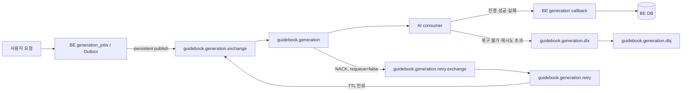

# AI MQ 소비 계약 및 완전 전환 계획

관련 Issue: #330  
선행 작업: #308, Draft PR #320  
관련 요구사항: BR-GDE-16, FR-GDE-01/02/07/08/09

## 문서 상태와 머지 조건

이 문서는 RabbitMQ 발행 코드와 별도로 관리한다. 아래 조건이 모두 충족되기 전에는 이 문서 PR을
`dev`에 머지하지 않는다.

- AI consumer가 본 문서의 메시지, ACK, 멱등성, retry, DLQ, callback 계약을 승인한다.
- AI consumer 구현이 완료된다.
- staging에서 BE 발행 → RabbitMQ → AI 소비 → BE callback 흐름을 검증한다.
- 최초 생성, 재생성, 사용자 수동 재시도, 중복 전달, 일시 장애, 타임아웃 시나리오를 확인한다.
- 이 문서 PR 머지와 함께 HTTP/MQ 이중 경로를 제거하는 완전 전환 코드를 반영한다.

문서만 먼저 머지하여 아직 존재하지 않는 consumer 동작을 완료된 계약처럼 취급하지 않는다.

## 전체 구조



BE는 생성·재생성 입력을 DB에 먼저 저장한 뒤 RabbitMQ에 발행한다. RabbitMQ publisher confirm ACK를
받은 경우에만 작업을 내부 `QUEUED` 상태로 바꾼다. confirm 실패·타임아웃·returned message는
`PUBLISH_PENDING`을 유지하고 DB Outbox에서 재발행한다.

## RabbitMQ 토폴로지

| 역할 | 이름 | routing key |
| --- | --- | --- |
| 최초 발행 exchange | `guidebook.generation.exchange` | `guidebook.generation` |
| 메인 quorum queue | `guidebook.generation` | - |
| retry exchange | `guidebook.generation.retry.exchange` | `guidebook.generation.retry` |
| retry quorum queue | `guidebook.generation.retry` | - |
| dead-letter exchange | `guidebook.generation.dlx` | `guidebook.generation.failed` |
| dead-letter quorum queue | `guidebook.generation.dlq` | - |

메인 큐에서 `NACK(requeue=false)`된 메시지는 retry queue로 이동한다. retry queue의 TTL이 지나면
메인 exchange로 돌아온다. quorum dead-letter 전달은 `x-dead-letter-strategy=at-least-once`,
`x-overflow=reject-publish`를 사용한다.

## 메시지 계약

최초 생성과 재생성은 같은 큐를 사용하고 `jobType`으로 구분한다.

```json
{
  "schemaVersion": 1,
  "messageId": "123-0",
  "jobId": 123,
  "attempt": 0,
  "jobType": "INITIAL",
  "input": {
    "request_id": "123-0"
  }
}
```

- `messageId`: `{BE jobId}-{attempt}`. 자동 재발행과 RabbitMQ 재전달에서는 유지한다.
- `jobId`: BE `generation_jobs.id`. callback의 `backend_job_id`와 같다.
- `attempt`: 사용자 수동 재시도 회차. 이전 회차 callback은 BE가 무시한다.
- `jobType`: `INITIAL` 또는 `REGENERATION`.
- `input`: 최초 생성은 여행 조건·취향·후보 콘텐츠를 포함한다.
- 재생성 input은 최초 입력 스냅샷에 `source_job_id`, `source_guidebook_version`, `title`,
  `feedback`, `previous_plan`을 추가한다.

`previous_plan` 항목은 `content_id`, `day`, `order`, `start_time`, `duration_minutes`로 구성한다.
재생성은 최신 관광 후보를 재조회하지 않고 원본 입력과 현재 저장 일정을 사용한다.

## 전달 보장과 AI 멱등성

전달 보장은 at-least-once다. publisher confirm 응답 유실, BE 재기동, consumer 연결 종료로 동일한
`messageId`가 여러 번 전달될 수 있다.

AI는 작업 저장소에서 `messageId`를 UNIQUE로 관리한다.

1. 처음 본 `messageId`이면 AI 작업을 영속화한다.
2. 영속화 트랜잭션이 커밋된 뒤 RabbitMQ ACK를 보낸다.
3. 이미 PROCESSING 또는 COMPLETED인 메시지는 새 LLM 작업을 만들지 않고 ACK한다.
4. PROCESSING 작업의 실행 주체가 사라질 수 있다면 lease/heartbeat 만료 후 회수한다.
5. 사용자 수동 재시도는 `attempt`와 `messageId`가 바뀌므로 새로운 실행으로 처리한다.

LLM 실행 완료까지 RabbitMQ delivery를 unacked로 유지하지 않는다. ACK는 LLM 완료가 아니라
AI 내부 작업의 안전한 접수를 의미한다.

## ACK, retry, DLQ 정책

| 상황 | AI consumer 처리 |
| --- | --- |
| 검증 성공 및 AI 작업 저장 성공 | ACK |
| 동일 `messageId` 작업이 이미 존재 | 중복 실행 없이 ACK |
| AI 저장소 연결 실패 등 접수 단계의 일시 오류 | NACK, `requeue=false` |
| JSON, schemaVersion, jobType 등 복구 불가능한 오류 | DLX 발행 confirm 후 원본 ACK |
| `x-death` 기반 접수 재시도 한도 초과 | DLX 발행 confirm 후 원본 ACK |
| ACK 이후 LLM 실행 실패 또는 실행 타임아웃 | MQ 재시도 없이 FAILED callback |

consumer는 `x-death` 헤더로 접수 재시도 횟수를 판단하고 무한 NACK를 허용하지 않는다. 최대 횟수는
AI 운영 정책에서 확정한다. DLQ 발행은 publisher confirm을 확인한 뒤 원본 메시지를 ACK하여 격리
과정의 유실을 막는다.

## callback과 타임아웃

AI는 기존 내부 callback을 사용한다.

```text
POST /internal/v1/ai/generation-events
```

- callback에는 `backend_job_id=jobId`와 `attempt`를 포함한다.
- 진행 단계와 최종 성공·실패 결과를 callback으로 전달한다.
- AI 작업 저장 이후 LLM 실패·타임아웃은 같은 MQ 메시지를 재처리하지 않고 FAILED callback한다.
- BE는 현재 attempt와 종료 상태를 다시 확인하여 이전 회차·중복 최종 callback을 무시한다.
- BE의 전체 생성 제한 시간 기본값 15분과 AI 내부 모델 호출 제한은 별도다.

## 초기 consumer 운영값

- manual ACK
- consumer concurrency 1
- prefetch 1
- `messageId`, `jobId`, `attempt`, `jobType`, `x-death` 구조화 로그
- 메인/retry/DLQ 큐 적재량 모니터링
- 소비 지연, callback 실패, DLQ 신규 적재 알림

## 완전 전환 시 코드 제거

AI 계약과 staging 통합 검증이 완료되면 이 문서 PR의 머지와 함께 MQ 단일 경로 전환 PR을 반영한다.

### 경로 선택 제거

- `AI_GENERATION_OUTBOX_ENABLED`
- `ai.generation.outbox-enabled`
- MQ 관련 컴포넌트의 경로 선택용 `ConditionalOnProperty`
- MQ/HTTP 이중 경로 조건 분기

MQ가 유일한 생성 전달 경로가 되므로 활성화 flag를 운영 토글로 남기지 않는다.

### 기존 HTTP 제출 제거

- `GuidebookAiClient.requestGeneration`
- `GuidebookAiClient.requestRegeneration`
- `HttpGuidebookAiClient`의 생성·재생성 접수 경로
- `GenerationCallbackSubmissionService`의 AI HTTP 접수
- HTTP 접수 전용 `AiGuidebookRegenerationRequest`
- AI 접수용 base URL, connect timeout, read timeout 설정 중 더 이상 사용하지 않는 값

상태 callback 클라이언트나 다른 용도로 실제 사용 중인 설정은 참조를 확인한 뒤 제거한다.

### 메모리 제출 큐 제거

- `GenerationSubmissionQueue`
- 메모리 동시 실행 슬롯과 wakeup 로직
- 커밋 후 HTTP submit을 위한 `Propagation.NEVER`, `writes.execute()` 경계
- HTTP 접수를 위해 유지하던 admission 결과와 분기

접수 트랜잭션은 입력 스냅샷과 Outbox 발행 대기 상태를 함께 저장하는 단일 DB 트랜잭션으로
단순화한다. RabbitMQ 발행은 저장 커밋 이후 Outbox publisher가 담당한다.

### 레거시 AI 작업 ID 의존 제거

- `source_ai_job_id` 기반 재생성 전달
- `ai_job_id` 기반 재생성 원본 선택
- 기존 HTTP 작업 호환을 위한 상태·선택 분기

기존 진행 작업을 소진하거나 이관한 뒤 제거한다. DB 컬럼 제거가 필요하면 별도 migration으로 수행하고,
운영 데이터가 남아 있는 상태에서 바로 삭제하지 않는다.

### 유지 대상

- `generation_jobs` 요청·메시지 스냅샷
- DB Outbox 발행, publisher confirm, 발행 backoff
- AI 진행·성공·실패 callback
- 결과 검증·저장과 생성권 차감 트랜잭션
- 생성 전용 SSE와 완료 알림
- 사용자 수동 재시도 횟수·권한 정책
- 늦은 attempt 및 중복 callback 차단

## 완전 전환 검증 체크리스트

- [ ] INITIAL 메시지를 AI가 소비하고 성공 callback한다.
- [ ] REGENERATION 메시지를 `previous_plan`과 `feedback`으로 처리한다.
- [ ] 동일 `messageId` 중복 전달이 LLM 중복 실행을 만들지 않는다.
- [ ] AI 접수 전 일시 장애가 retry queue를 거쳐 복구된다.
- [ ] 접수 재시도 초과·잘못된 메시지가 DLQ에 격리된다.
- [ ] LLM 실패·타임아웃이 FAILED callback으로 종료된다.
- [ ] 사용자 수동 재시도는 새 `messageId`로 실행된다.
- [ ] 이전 attempt의 늦은 callback이 현재 결과를 덮어쓰지 않는다.
- [ ] RabbitMQ 중단 중 `PUBLISH_PENDING`이 유지되고 복구 후 발행된다.
- [ ] HTTP 제출·메모리 큐·경로 선택 flag 제거 후 전체 테스트가 통과한다.
- [ ] staging 환경에서 큐 적재량, 소비 지연, DLQ, callback 실패를 관찰할 수 있다.
