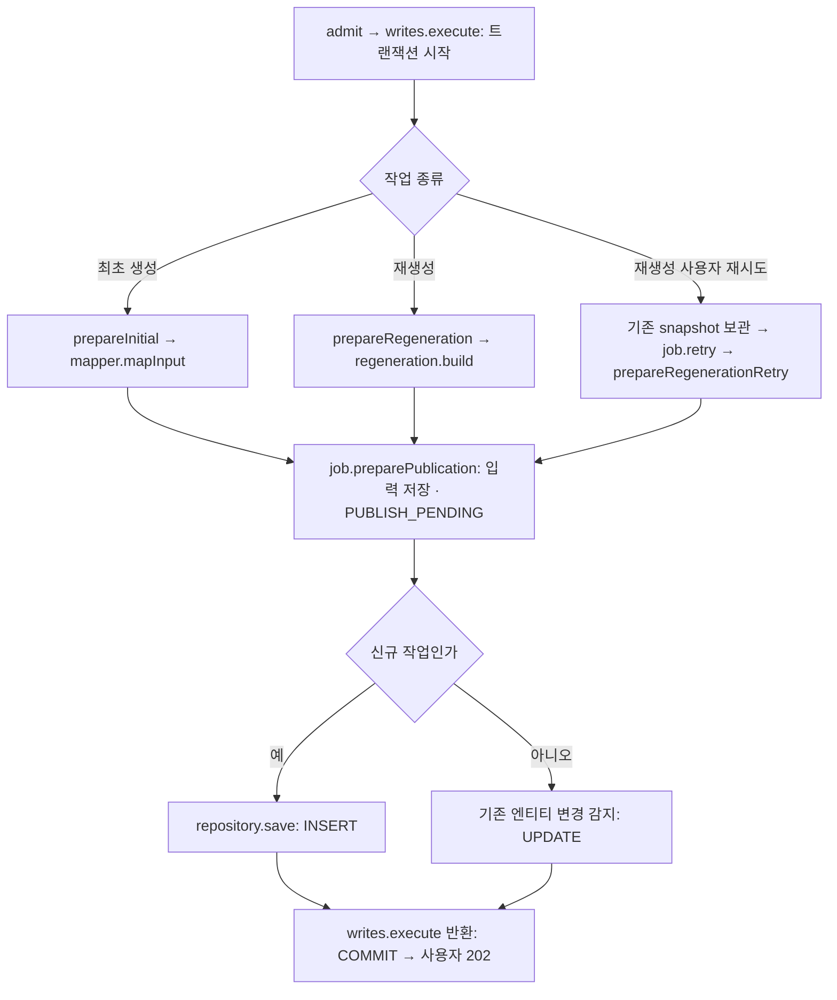
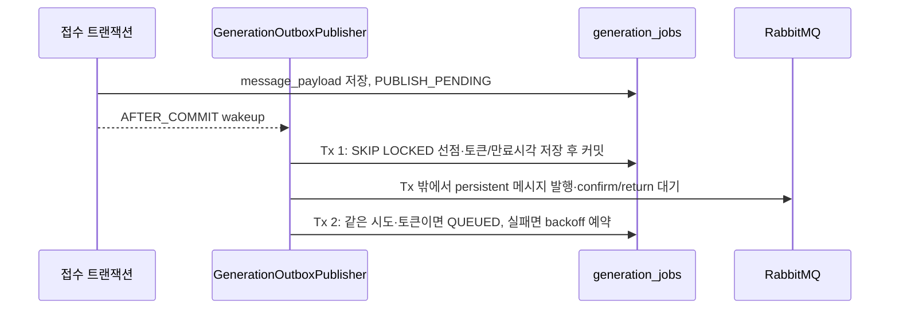

# AI MQ 재생성 입력 스냅샷 (#308 후속)

관련 요구사항: BR-GDE-16, FR-GDE-07/08/09. PR #316의 저장 전 입력 스냅샷 구조를 확장한다.
RabbitMQ 발행기는 이 후속 단계에서 구현한다. AI 소비는 아직 구현하지 않으며, 기본 HTTP 경로와 사용자 정책은 유지한다.
전환 중에는 RabbitMQ가 API 기동 필수 의존성이 아니므로 기본 health/readiness에서 Rabbit health contributor를 제외한다.
실제 AI 소비를 운영 활성화할 때는 브로커 장애를 어떻게 readiness에 반영할지 별도로 정한다.

## 입력 원본

- MQ 준비 경로에서는 최근 COMPLETED 작업을 completed_at DESC, id DESC로 선택한다.
- AI가 발급한 ID가 아닌 BE GenerationJob ID를 사용한다.
- 원본 message_payload.input의 여행 조건/취향/contents를 복사한다. 후보를 최신 DB로 재조회하지 않는다.
- 현재 guidebook 제목/version과 itinerary_days/items의 일정 스냅샷을 읽는다.
- source_job_id, source_guidebook_version, title, feedback, previous_plan을 덮어쓴다.
- previous_plan은 content_id, day, order, start_time, duration_minutes의 배열이다.
  이는 AI의 PlanItem 입력 형식이며 기존 HTTP 재생성 API의 본문과 동일하지 않다.
- title은 기존 제목 보존용이다. AI 소비 구현 때 날짜/시간 및 PlanItem 변환 계약을 함께 검증해야 한다.

## 저장과 재시도

접수 트랜잭션에서 {schemaVersion:1,input:{...}}을 만든 뒤 작업과 함께 저장한다.
실패 시 전부 롤백한다. 발행 시 jobId/messageId/attempt/jobType과 input.request_id를 붙인다.
사용자 재시도는 최초 재생성 접수의 입력을 재사용한다. 현재 일정이나 후보를 다시 조회하지 않는다.
원본 스냅샷은 수정하지 않는다. 발행 재시도·사용자 재시도는 기존 정책대로 분리한다.

## 전환 경계

- 원본 후보 스냅샷이 없는 기존 HTTP 작업은 활성화된 MQ 경로에서 409로 거절한다.
  원본이 없는 것을 최신 후보로 조용히 대체하지 않는다. 기존 작업의 전환 정책은 후속 결정이다.
- 기본 false 설정에서는 기존 ai_job_id 기반 HTTP 재생성을 유지한다.
- AI 소비·실행 복구 구현 전 운영 활성화하지 않는다.
- 최종 전환 후 HTTP 경로와 경로 선택 설정/분기를 제거한다.
- FE 공개 상태는 기존과 동일하다. 접수·조회·SSE에서 내부 대기 상태는 PENDING으로 반환한다.
  기존 작업의 전환 오류 안내는 운영 활성화 전에 별도로 검토한다.

## 최종 MQ 전환 후 제거/단순화할 코드

| 현재 코드 | 전환 완료 후 처리 |
| --- | --- |
| ai.generation.outbox-enabled / ConditionalOnProperty / 빈 존재 여부 기반 분기 | 제거하고 MQ 준비를 단일 경로로 사용 |
| GenerationSubmissionQueue 및 admit()의 커밋 후 submit 호출 | 공유 MQ 발행기로 대체 |
| admit()의 writes.execute() 및 접수 진입점 Propagation.NEVER | HTTP 큐 전달이 사라진 뒤 접수 서비스를 @Transactional로 단순화. DB 트랜잭션 자체는 유지 |
| Admission.jobId의 HTTP 전달 대상/null 구분 | 커밋 후 HTTP 전달 조정이 없어지면 제거 |
| GenerationCallbackSubmissionService와 AI HTTP 접수 클라이언트 | 실제 AI 직접 소비 전환·기존 진행 작업 정리 후 제거 |
| source_ai_job_id / ai_job_id 기반 재생성 원본 선택 / 기존 PENDING 호환 상태 | 기존 작업 소진·스냅샷 이관 정책 적용 후 제거 |

결과 저장·권한·멱등 처리·사용자 202 응답과 DB 트랜잭션은 유지한다.
진행/결과 콜백은 실제 AI 결과 전달 계약을 확정하기 전 일괄 제거하지 않는다.
현재 writes.execute()는 저장 트랜잭션이 반환되어 커밋된 다음 HTTP 큐에 등록하기 위한 경계다.
MQ 발행기는 별도로 DB를 조회하므로 최종 경로에서는 이 커밋 후 전달 조정이 필요하지 않다.

## 함수 흐름

buildMessage(job)는 요청 접수 흐름에서 호출하지 않는다.
발행기가 저장된 입력에 jobId/attempt/messageId/jobType을 붙여 MQ에 보낼 때 사용한다.
위 도식의 트랜잭션은 맨 처음부터 COMMIT까지 전체를 감싸며 save 뒤에 시작되는 것이 아니다.

## 발행기 흐름

`GenerationOutboxPublisher`는 접수 트랜잭션의 AFTER_COMMIT 이벤트로 즉시 한 번 깨어나고,
500ms 폴링으로 누락된 이벤트·재발행 예약·만료 선점을 회수한다. 이벤트는 지연을 줄이는 신호일 뿐
전달 보장의 근거가 아니다.

발행 확인 직전/직후 프로세스가 종료되면 같은 `messageId`가 재발행될 수 있다. 따라서 후속 AI 소비자는
`messageId` 기준 중복 처리를 해야 한다. 선점 토큰은 만료된 선점을 다른 인스턴스가 회수한 뒤
이전 발행기의 늦은 결과가 현재 작업 상태를 덮어쓰지 못하게 한다.
