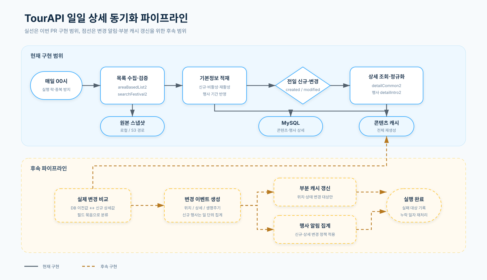

# TourAPI 상세 동기화 파이프라인

## 이번 구현 범위

- 매일 실행하는 기존 목록 동기화가 완료되면 전날 `createdtime` 또는 `modifiedtime`에 해당하는 콘텐츠를 선별한다.
- 선별 대상은 서비스에서 사용하는 대분류(`NA`, `HS`, `VE`, `EX`, `LS`, `EV`)로 제한한다.
- 모든 대상은 `detailCommon2`, 행사(`EV`)는 `detailIntro2`까지 호출한다.
- 원본 응답은 실행 ID와 콘텐츠 ID 단위로 로컬 또는 S3에 저장한다.
- 공통 상세는 `tourism_contents`, 행사 상세는 `event_details`에 정규화한다.
- 한 콘텐츠의 상세 조회가 실패해도 나머지 대상은 계속 처리하고 성공·실패 건수를 로그로 남긴다.
- 목록·행사·상세의 이전값과 신규값을 비교해 실제로 달라진 필드만 만든다.
- 같은 콘텐츠에서 발견한 목록·행사·상세 변경을 하나의 `ContentChangeSet`으로 병합한다.
- 목록 반영은 신규, 기존 갱신, 응답 누락에 따른 비활성화의 세 경우로 구분한다. 비활성 콘텐츠가 다시 응답에 들어오면 별도 재활성 사건으로 관리하지 않고 기존 콘텐츠 갱신으로 처리하여 `status=ACTIVE`, `deleted_at=NULL`로 복구한다.
- 지도 응답에 영향을 주는 변경만 선별해 이전·현재 좌표의 타일 캐시를 DB에서 다시 조회해 교체한다.
- 데이터 변경이 없어도 날짜 경과로 노출에서 빠지는 행사가 있으므로, 전날 종료된 행사의 좌표도 부분 갱신 대상에 포함한다.
- 캐시 초기 스냅샷이 준비되지 않은 경우에만 전체 갱신으로 fallback하고, 부분 갱신 타일 수와 fallback 여부를 로그로 남긴다.

## 후속 구현 범위

- 소개·운영정보 변경 필드 중 사용자에게 의미 있는 필드만 행사 알림 후보로 변환한다.
- 당일 신규 행사는 개별 알림 대신 일 단위로 집계하여 알림과 신규 행사 목록에 사용한다.
- 실패한 콘텐츠와 미처리 기준일을 영속화하여 다음 실행에서 재처리한다.

## 선택 근거

- `modifiedtime`은 무엇이 바뀌었는지를 알려주지 않으므로 상세 API 응답과 현재 DB 값을 비교해야 한다.
- `detailInfo2`의 행사소개·행사내용은 `detailCommon2.overview`와 중복 가능성이 있어 이번 수집 대상에서 제외한다.
- 원본 JSON은 변경 추적과 재처리를 위해 보존하되, MySQL에는 공통 소개·홈페이지·연락처와 행사 운영시간·주최자·주최자 연락처·장소만 정규화한다.
