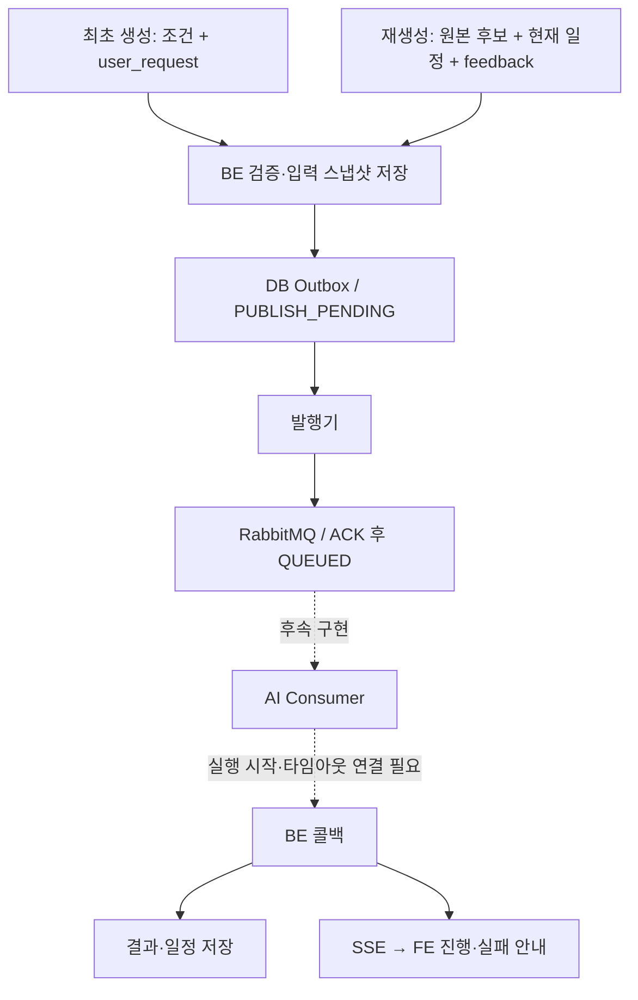

# MQ 기준 가이드북 생성·재생성 구조

관련 이슈: #337. 요구사항: FR-GDE-01/02/07/08/09, BR-GDE-02/03/04/13/16.
이 문서는 현재 BE 구현과 후속 Consumer 연동 경계를 구분한다. MQ end-to-end 완료를 의미하지 않는다.
기본 설정은 AI_GENERATION_OUTBOX_ENABLED=false이며 이때 기존 HTTP 접수 경로를 사용한다.

## 현재 구현과 후속 경계

점선은 미구현·미연결 경계다. 현재 MQ 작업은 실행 시작 시각이 없어 콜백이 409로 거절되며,
Consumer 연동 전에는 위 흐름의 end-to-end 동작을 보장하지 않는다. 상세 실패 처리는 아래 표를 따른다.

## 최초 생성과 재생성 입력

| 항목 | 최초 생성 | 재생성 |
| --- | --- | --- |
| 사용자 자연어 | 선택 user_request, trim 후 1~200자, null/누락 허용 | 필수 feedback, trim 후 1~200자 |
| 여행 조건 | 접수 요청 | 최근 완료 작업의 원본 입력 |
| 후보 | 최초 준비 시 DB 조회 후 전체 입력 스냅샷 저장 | 원본 message_payload.input.contents 복사, 최신 DB 재조회 없음 |
| 현재 일정 | 없음 | itinerary_days/items에서 previous_plan 구성 |
| 최초 user_request | HTTP/MQ 생성 입력에 포함 | DB 이력은 보존하되 MQ 전송본에서는 제거 |
| 성공 | 새 가이드북 생성 + 생성권 1개 차감 | 같은 가이드북 본문·일정 교체 + version 증가, 생성권 미차감 |
| 실패 | 가이드북 미생성, 생성권 미차감 | 기존 결과와 성공 횟수 유지 |

재생성은 최초 생성 완료 후 10분 이내·성공 최대 3회 정책을 유지한다.
사용자 재시도는 처음 접수한 재생성 입력을 재사용한다.
HTTP 작업처럼 원본 MQ 후보 스냅샷이 없는 작업은 MQ 재생성에서 409로 거절한다.

## 이미 처리한 실패와 아직 안 된 실패 처리

| 상황 | 현재 동작 | 남은 작업 |
| --- | --- | --- |
| HTTP 400/422의 알려진 입력 코드 | 입력/날짜/취향/피드백/후보 부족으로 분류, FAILED·retryable=false·SSE | AI가 포괄 invalid_request만 주면 더 세밀한 원인은 구분 불가 |
| HTTP 429 | AI_RATE_LIMITED·FAILED·사용자 재시도 가능 | 자동 접수 재시도는 하지 않음 |
| HTTP 503 | 접수 실패 확정·FAILED·사용자 재시도 가능 | 외부 장애 세부 원문은 공개하지 않음 |
| HTTP 연결 거절·연결/읽기 timeout | 불확실 접수 로그, 기본 15분 후 GENERATION_TIMEOUT | 연결 미성립과 접수 후 응답 유실을 구분한 즉시 실패 처리 미구현 |
| MQ broker 연결 실패/NACK/confirm timeout/unroutable | Outbox 대기와 원인 코드 저장, 2~60초 백오프 재발행 | 최대 횟수·대기 만료·최종 사용자 실패/복구 정책 미정 |
| MQ 발행 입력 손상 | 즉시 FAILED, GENERATION_REQUEST_INVALID, retryable=false | 복구 불가능한 입력은 자동 발행에서 제외 |
| MQ 발행 성공·Consumer 중단 | QUEUED, FE는 접수 대기 | Consumer 감지·소비 대기 만료·실행 복구 미구현 |
| MQ 작업의 최초 callback | 현재 attempt_started_at이 없어 409 | 실행 시작 시각 설정, ai_job_id 결합, 타이머 등록·재시작 복구를 Consumer 연동과 함께 구현 |
| Consumer 처리 실패·DLQ 도달 | Retry/DLQ 토폴로지 선언만 존재 | 소비 재시도 한도·DLQ 판정·BE FAILED 통지·수동 복구 미구현 |
| BE 타임아웃 후 늦은 AI 완료 | 종료된 시도 callback 무시, 생성권 미차감 | 사후 결과 복구는 이 PR 범위 밖 |

FE 진행바는 전송 방식이 아닌 callback → SSE의 progress.step을 사용한다.
따라서 Consumer가 생기면 UI를 그대로 재사용할 수 있지만, 현재 MQ 전환만으로 동작을 보장하지 않는다.
HTTP 접수 오류 분류를 MQ Consumer 오류 처리로 구현했다고 해석하면 안 된다.

## 실패 후 사용자 동선

- 본인 작업 상태 GET은 initial_request(재생성도 원본 조건)와 submitted_feedback을 반환한다.
- 입력 오류는 같은 내용의 기술 재시도를 막고 조건 수정·피드백 수정으로 연결한다.
- 재생성 실패의 조건 변경은 별도 최초 생성이다. 기존 가이드북 유지 및 새 생성 성공 시 생성권 사용을 안내한다.
- 실패 배너 취소는 FE 추적만 해제한다. DB는 FAILED를 유지하며 CANCELED로 변경하지 않는다.
- 상세 원문·토큰·AI 내부 진단은 공개 오류에 포함하지 않는다. 기존 포괄 실패 이력은 세부 원인을 소급 복원하지 못한다.

## 구현 근거

- guidebook/service/GuidebookGenerationService: 접수·멱등·스냅샷·상태 조회.
- guidebook/messaging/GenerationMessagePreparation: 입력 영속화·메시지 식별자·전송본 구성.
- guidebook/messaging/RegenerationInputSnapshot: 원본 후보와 현재 DB 일정 조합.
- guidebook/messaging/GenerationOutboxPublisher 및 entity/GenerationJob: 선점·confirm·재발행·공개 상태.
- guidebook/callback/GenerationCallbackTransactionService: 실행 시각 gate·콜백·타임아웃·종료 시도 무시.
- guidebook/service/GuidebookResultService 및 callback/GenerationStreamService: 결과 저장·생성권·SSE.
