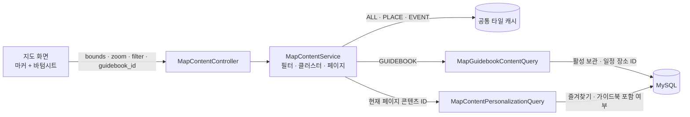

# 지도 콘텐츠 필터 조회 아키텍처

지도 마커와 바텀시트는 동일한 `filter`와 `guidebook_id` 조건을 사용한다. 일반 필터는 기존 공통 타일 캐시를 재사용하고, 가이드북 필터만 사용자의 활성 가이드북 일정 장소 ID를 조회해 캐시 결과와 교집합을 만든다.

## 핵심 규칙

- `ALL`, `PLACE`, `EVENT`: 공통 캐시에서 콘텐츠 타입만 선별한다.
- `GUIDEBOOK`: 가장 가까운 여행의 가이드북 ID를 받고, 일정에 포함된 장소 ID와 캐시 결과의 교집합을 반환한다.
- 가이드북 장소는 수가 적으므로 줌 레벨과 관계없이 클러스터링하지 않고 개별 핀으로 반환한다.
- 지도와 바텀시트가 같은 필터 결과를 사용하며, 바텀시트는 현재 페이지에 대해서만 개인화 정보를 일괄 조회한다.
- 가이드북 일정 관계는 사용자별 데이터이므로 공통 타일 캐시에 넣지 않는다.

다이어그램의 컴포넌트별 소스 근거는 [Archify 정의](../../.archify/architecture-map-content-filter-20261106-175534/candidate.json)에서 확인할 수 있다.
