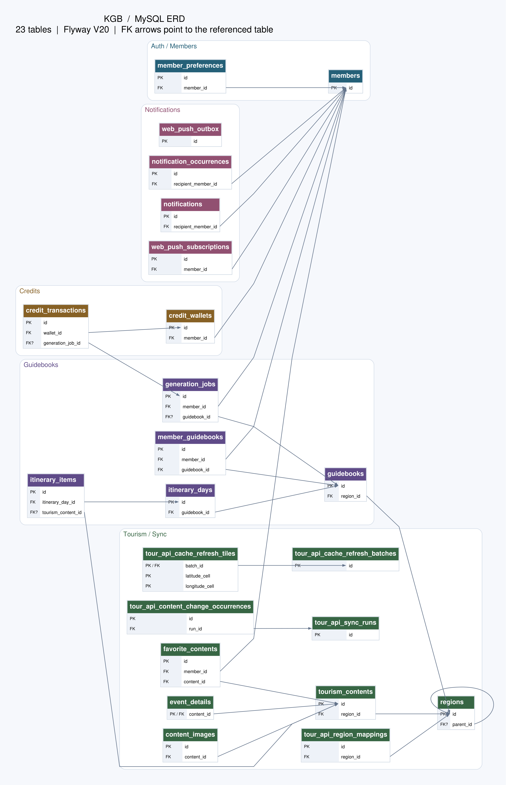

# 테이블 정의서 최종본

> 2026-11-24 · 백엔드 `dev` (`277bd55`) · MySQL 8 / Flyway V20

로컬 MySQL의 Flyway 적용 결과를 기준으로 업무 테이블 23개를 정리했다. DDL에는 테이블과 제약조건만 포함한다.

[ERD 이미지](./KGB-ERD-최종.png) · [확대용 SVG](./KGB-ERD-최종.svg) · [ERDCloud SQL](./ERDCloud_schema_final.sql) · [요구사항 최종본](./요구사항정의서-최종.md)

## 주요 데이터 규칙

- 로그인 세션은 Redis에 저장한다. MySQL은 회원 및 취향 정보를 보관한다.
- `generation_jobs`는 생성·재생성 요청과 전달 상태를 기록한다. 진행 중 상태는 `PENDING`, `PUBLISH_PENDING`, `QUEUED`, `PROCESSING`이며 회원별 진행 중 작업을 유일 키로 제한한다. API는 발행·실행 대기 상태를 `PENDING`으로 응답한다.
- `attempt_count`는 사용자가 다시 시도한 횟수다. `publish_attempt_count`와 `next_publish_at`은 MQ 발행 재시도에 사용한다.
- 일정은 `itinerary_days`와 `itinerary_items`로 관리하며, 계정별 보관 관계는 `member_guidebooks`가 관리한다.
- 아래 기본값의 `—`는 별도 기본값이 없는 컬럼을 뜻한다. 컬럼 이름은 DB 물리 이름이다.

## 테이블 목록

- **Auth / Members** · [members](#members), [member_preferences](#member_preferences)
- **Tourism / Sync** · [regions](#regions), [tour_api_region_mappings](#tour_api_region_mappings), [tourism_contents](#tourism_contents), [content_images](#content_images), [event_details](#event_details), [favorite_contents](#favorite_contents), [tour_api_sync_runs](#tour_api_sync_runs), [tour_api_content_change_occurrences](#tour_api_content_change_occurrences), [tour_api_cache_refresh_batches](#tour_api_cache_refresh_batches), [tour_api_cache_refresh_tiles](#tour_api_cache_refresh_tiles)
- **Guidebooks** · [guidebooks](#guidebooks), [member_guidebooks](#member_guidebooks), [generation_jobs](#generation_jobs), [itinerary_days](#itinerary_days), [itinerary_items](#itinerary_items)
- **Notifications** · [notifications](#notifications), [notification_occurrences](#notification_occurrences), [web_push_subscriptions](#web_push_subscriptions), [web_push_outbox](#web_push_outbox)
- **Credits** · [credit_wallets](#credit_wallets), [credit_transactions](#credit_transactions)

## Auth / Members

### members

회원, OAuth 식별 정보, 프로필과 설정

| 컬럼 | 타입 | NULL 허용 | 기본값 | 속성 · 설명 |
|---|---|---|---|---|
| `id` | `bigint` | NO | — | PK · auto_increment |
| `oauth_provider` | `varchar(20)` | NO | — | — |
| `oauth_subject` | `varchar(255)` | NO | — | — |
| `nickname` | `varchar(50)` | NO | — | — |
| `email` | `varchar(254)` | YES | `NULL` | — |
| `profile_image_url` | `varchar(2048)` | YES | `NULL` | — |
| `language_code` | `varchar(10)` | NO | `ko` | — |
| `status` | `varchar(20)` | NO | `ONBOARDING` | — |
| `push_enabled` | `tinyint(1)` | NO | `1` | — |
| `deleted_at` | `datetime(6)` | YES | `NULL` | — |
| `created_at` | `datetime(6)` | NO | — | — |
| `updated_at` | `datetime(6)` | NO | — | — |

**키와 인덱스**

- INDEX `ix_members_status` · `status` · BTREE
- PK `PRIMARY` · `id` · BTREE
- UNIQUE `uq_members_oauth` · `oauth_provider, oauth_subject` · BTREE

### member_preferences

회원이 선택한 취향 Enum 코드

| 컬럼 | 타입 | NULL 허용 | 기본값 | 속성 · 설명 |
|---|---|---|---|---|
| `id` | `bigint` | NO | — | PK · auto_increment |
| `member_id` | `bigint` | NO | — | FK |
| `preference_type` | `varchar(20)` | NO | — | — |
| `preference_code` | `varchar(50)` | NO | — | — |

**키와 인덱스**

- INDEX `ix_member_preferences_code` · `preference_type, preference_code` · BTREE
- PK `PRIMARY` · `id` · BTREE
- UNIQUE `uq_member_preferences_selection` · `member_id, preference_type, preference_code` · BTREE
- FK `fk_member_preferences_member` · `member_id` → [members](#members) (`id`) · UPDATE NO ACTION / DELETE NO ACTION

## Tourism / Sync

### regions

17개 광역 시도 지역 기준 정보

| 컬럼 | 타입 | NULL 허용 | 기본값 | 속성 · 설명 |
|---|---|---|---|---|
| `id` | `bigint` | NO | — | PK · auto_increment |
| `parent_id` | `bigint` | YES | `NULL` | FK |
| `administrative_code` | `varchar(20)` | NO | — | — |
| `name` | `varchar(100)` | NO | — | — |
| `region_level` | `varchar(20)` | NO | `PROVINCE` | — |

**키와 인덱스**

- INDEX `ix_regions_parent_name` · `parent_id, name` · BTREE
- PK `PRIMARY` · `id` · BTREE
- UNIQUE `uq_regions_administrative_code` · `administrative_code` · BTREE
- FK `fk_regions_parent` · `parent_id` → [regions](#regions) (`id`) · UPDATE NO ACTION / DELETE NO ACTION
- CHECK `ck_regions_hierarchy` · `(((region_level = _utf8mb4\'PROVINCE\') and (parent_id is null)) or ((region_level = _utf8mb4\'DISTRICT\') and (parent_id is not null)))` · 적용

### tour_api_region_mappings

TourAPI 원본 지역 코드와 서비스 2단계 지역의 매핑

| 컬럼 | 타입 | NULL 허용 | 기본값 | 속성 · 설명 |
|---|---|---|---|---|
| `id` | `bigint` | NO | — | PK · auto_increment |
| `source_provider` | `varchar(30)` | NO | — | — |
| `source_region_code` | `varchar(20)` | NO | — | — |
| `source_district_code` | `varchar(20)` | NO | — | — |
| `region_id` | `bigint` | NO | — | FK |
| `created_at` | `datetime(6)` | NO | — | — |
| `updated_at` | `datetime(6)` | NO | — | — |

**키와 인덱스**

- INDEX `ix_tour_api_region_mappings_region` · `region_id` · BTREE
- PK `PRIMARY` · `id` · BTREE
- UNIQUE `uq_tour_api_region_mappings_source` · `source_provider, source_region_code, source_district_code` · BTREE
- FK `fk_tour_api_region_mappings_region` · `region_id` → [regions](#regions) (`id`) · UPDATE NO ACTION / DELETE NO ACTION

### tourism_contents

관광 콘텐츠 공통 원본

| 컬럼 | 타입 | NULL 허용 | 기본값 | 속성 · 설명 |
|---|---|---|---|---|
| `id` | `bigint` | NO | — | PK · auto_increment |
| `source_provider` | `varchar(30)` | NO | — | — |
| `source_content_id` | `varchar(100)` | NO | — | — |
| `source_content_type_id` | `varchar(20)` | YES | `NULL` | — |
| `title` | `varchar(200)` | NO | — | — |
| `description` | `text` | YES | `NULL` | — |
| `region_id` | `bigint` | NO | — | FK |
| `source_region_code` | `varchar(20)` | YES | `NULL` | — |
| `source_district_code` | `varchar(20)` | YES | `NULL` | — |
| `classification_code_1` | `varchar(20)` | YES | `NULL` | — |
| `classification_code_2` | `varchar(20)` | YES | `NULL` | — |
| `classification_code_3` | `varchar(20)` | YES | `NULL` | — |
| `address` | `varchar(500)` | YES | `NULL` | — |
| `location` | `point` | NO | — | SRID 4326 |
| `phone` | `varchar(50)` | YES | `NULL` | — |
| `homepage_url` | `varchar(2048)` | YES | `NULL` | — |
| `thumbnail_url` | `varchar(2048)` | YES | `NULL` | — |
| `source_created_at` | `datetime(6)` | YES | `NULL` | — |
| `source_modified_at` | `datetime(6)` | YES | `NULL` | — |
| `status` | `varchar(20)` | NO | `ACTIVE` | — |
| `deleted_at` | `datetime(6)` | YES | `NULL` | — |
| `created_at` | `datetime(6)` | NO | — | — |
| `updated_at` | `datetime(6)` | NO | — | — |

**키와 인덱스**

- INDEX `idx_tourism_contents_new_event_lookup` · `classification_code_1, status, deleted_at, source_created_at, id` · BTREE
- INDEX `ix_tourism_contents_active_created` · `status, deleted_at, created_at DESC, id DESC` · BTREE
- INDEX `ix_tourism_contents_location` · `location(32)` · SPATIAL
- INDEX `ix_tourism_contents_region_classification_1` · `region_id, classification_code_1` · BTREE
- INDEX `ix_tourism_contents_source_region` · `source_provider, source_region_code, source_district_code` · BTREE
- PK `PRIMARY` · `id` · BTREE
- UNIQUE `uq_tourism_contents_source` · `source_provider, source_content_id` · BTREE
- FK `fk_tourism_contents_region` · `region_id` → [regions](#regions) (`id`) · UPDATE NO ACTION / DELETE NO ACTION

### content_images

관광 콘텐츠 이미지

| 컬럼 | 타입 | NULL 허용 | 기본값 | 속성 · 설명 |
|---|---|---|---|---|
| `id` | `bigint` | NO | — | PK · auto_increment |
| `content_id` | `bigint` | NO | — | FK |
| `image_url` | `varchar(2048)` | NO | — | — |
| `image_url_hash` | `binary(32)` | NO | — | — |
| `sort_order` | `int` | NO | `0` | — |
| `source_url` | `varchar(2048)` | YES | `NULL` | — |
| `created_at` | `datetime(6)` | NO | — | — |

**키와 인덱스**

- INDEX `ix_content_images_content_order` · `content_id, sort_order` · BTREE
- PK `PRIMARY` · `id` · BTREE
- UNIQUE `uq_content_images_url_hash` · `content_id, image_url_hash` · BTREE
- FK `fk_content_images_content` · `content_id` → [tourism_contents](#tourism_contents) (`id`) · UPDATE NO ACTION / DELETE NO ACTION

### event_details

행사 콘텐츠 전용 상세

| 컬럼 | 타입 | NULL 허용 | 기본값 | 속성 · 설명 |
|---|---|---|---|---|
| `content_id` | `bigint` | NO | — | PK / FK |
| `start_date` | `date` | NO | — | — |
| `end_date` | `date` | NO | — | — |
| `operating_hours` | `varchar(255)` | YES | `NULL` | — |
| `organizer` | `varchar(200)` | YES | `NULL` | — |
| `organizer_phone` | `varchar(100)` | YES | `NULL` | — |
| `event_place` | `varchar(500)` | YES | `NULL` | — |
| `updated_at` | `datetime(6)` | NO | — | — |

**키와 인덱스**

- PK `PRIMARY` · `content_id` · BTREE
- FK `fk_event_details_content` · `content_id` → [tourism_contents](#tourism_contents) (`id`) · UPDATE NO ACTION / DELETE NO ACTION
- CHECK `ck_event_details_period` · `(start_date <= end_date)` · 적용

### favorite_contents

회원과 관심 관광 콘텐츠의 N:M 관계

| 컬럼 | 타입 | NULL 허용 | 기본값 | 속성 · 설명 |
|---|---|---|---|---|
| `id` | `bigint` | NO | — | PK · auto_increment |
| `member_id` | `bigint` | NO | — | FK |
| `content_id` | `bigint` | NO | — | FK |
| `created_at` | `datetime(6)` | NO | — | — |

**키와 인덱스**

- INDEX `fk_favorite_contents_content` · `content_id` · BTREE
- INDEX `ix_favorite_contents_member_created` · `member_id, created_at DESC, id DESC` · BTREE
- PK `PRIMARY` · `id` · BTREE
- UNIQUE `uq_favorite_contents_member_content` · `member_id, content_id` · BTREE
- FK `fk_favorite_contents_content` · `content_id` → [tourism_contents](#tourism_contents) (`id`) · UPDATE NO ACTION / DELETE NO ACTION
- FK `fk_favorite_contents_member` · `member_id` → [members](#members) (`id`) · UPDATE NO ACTION / DELETE NO ACTION

### tour_api_sync_runs

TourAPI 일일 동기화 실행 이력과 중복 실행 잠금

| 컬럼 | 타입 | NULL 허용 | 기본값 | 속성 · 설명 |
|---|---|---|---|---|
| `id` | `bigint` | NO | — | PK · auto_increment |
| `run_id` | `char(36)` | NO | — | — |
| `sync_date` | `date` | NO | — | — |
| `status` | `varchar(20)` | NO | — | — |
| `attempt_count` | `int` | NO | `0` | — |
| `source_contents` | `int` | YES | `NULL` | — |
| `imported_contents` | `int` | YES | `NULL` | — |
| `inactive_contents` | `int` | YES | `NULL` | — |
| `reactivated_contents` | `int` | YES | `NULL` | — |
| `source_events` | `int` | YES | `NULL` | — |
| `imported_events` | `int` | YES | `NULL` | — |
| `failure_stage` | `varchar(30)` | YES | `NULL` | — |
| `failure_message` | `varchar(1000)` | YES | `NULL` | — |
| `started_at` | `datetime(6)` | NO | — | — |
| `completed_at` | `datetime(6)` | YES | `NULL` | — |
| `created_at` | `datetime(6)` | NO | — | — |
| `updated_at` | `datetime(6)` | NO | — | — |

**키와 인덱스**

- INDEX `ix_tour_api_sync_runs_status_started` · `status, started_at` · BTREE
- PK `PRIMARY` · `id` · BTREE
- UNIQUE `uq_tour_api_sync_runs_run_id` · `run_id` · BTREE
- UNIQUE `uq_tour_api_sync_runs_sync_date` · `sync_date` · BTREE

### tour_api_content_change_occurrences

TourAPI 동기화 실행별 콘텐츠 변경 occurrence

| 컬럼 | 타입 | NULL 허용 | 기본값 | 속성 · 설명 |
|---|---|---|---|---|
| `id` | `bigint` | NO | — | PK · auto_increment |
| `run_id` | `char(36)` | NO | — | FK |
| `source_provider` | `varchar(30)` | NO | — | — |
| `source_content_id` | `varchar(100)` | NO | — | — |
| `lifecycle_change` | `varchar(30)` | NO | — | — |
| `changed_fields_json` | `json` | NO | — | — |
| `previous_latitude` | `decimal(10,7)` | YES | `NULL` | — |
| `previous_longitude` | `decimal(10,7)` | YES | `NULL` | — |
| `current_latitude` | `decimal(10,7)` | YES | `NULL` | — |
| `current_longitude` | `decimal(10,7)` | YES | `NULL` | — |
| `created_at` | `datetime(6)` | NO | — | — |
| `updated_at` | `datetime(6)` | NO | — | — |

**키와 인덱스**

- INDEX `ix_tour_api_content_change_source_created` · `source_provider, source_content_id, created_at` · BTREE
- PK `PRIMARY` · `id` · BTREE
- UNIQUE `uq_tour_api_content_change_occurrence` · `run_id, source_provider, source_content_id` · BTREE
- FK `fk_tour_api_content_change_occurrence_run` · `run_id` → [tour_api_sync_runs](#tour_api_sync_runs) (`run_id`) · UPDATE NO ACTION / DELETE NO ACTION

### tour_api_cache_refresh_batches

TourAPI 동기화별 지도 캐시 갱신 배치

| 컬럼 | 타입 | NULL 허용 | 기본값 | 속성 · 설명 |
|---|---|---|---|---|
| `id` | `bigint` | NO | — | PK · auto_increment |
| `run_id` | `char(36)` | NO | — | — |
| `created_at` | `datetime(6)` | NO | — | — |

**키와 인덱스**

- PK `PRIMARY` · `id` · BTREE
- UNIQUE `uq_tour_api_cache_refresh_batches_run_id` · `run_id` · BTREE

### tour_api_cache_refresh_tiles

TourAPI 동기화 후 각 인스턴스가 재로드할 0.5도 타일

| 컬럼 | 타입 | NULL 허용 | 기본값 | 속성 · 설명 |
|---|---|---|---|---|
| `batch_id` | `bigint` | NO | — | PK / FK |
| `latitude_cell` | `bigint` | NO | — | PK |
| `longitude_cell` | `bigint` | NO | — | PK |

**키와 인덱스**

- PK `PRIMARY` · `batch_id, latitude_cell, longitude_cell` · BTREE
- FK `fk_tour_api_cache_refresh_tiles_batch` · `batch_id` → [tour_api_cache_refresh_batches](#tour_api_cache_refresh_batches) (`id`) · UPDATE NO ACTION / DELETE CASCADE

## Guidebooks

### guidebooks

AI 생성 결과 가이드북

| 컬럼 | 타입 | NULL 허용 | 기본값 | 속성 · 설명 |
|---|---|---|---|---|
| `id` | `bigint` | NO | — | PK · auto_increment |
| `title` | `varchar(15)` | NO | — | — |
| `region_id` | `bigint` | NO | — | FK |
| `start_date` | `date` | NO | — | — |
| `end_date` | `date` | NO | — | — |
| `companion` | `varchar(20)` | NO | — | — |
| `people_count` | `int` | NO | — | — |
| `thumbnail_url` | `varchar(2048)` | YES | `NULL` | — |
| `content_html` | `text` | YES | `NULL` | — |
| `version` | `int` | NO | `1` | — |
| `created_at` | `datetime(6)` | NO | — | — |
| `updated_at` | `datetime(6)` | NO | — | — |

**키와 인덱스**

- INDEX `fk_guidebooks_region` · `region_id` · BTREE
- PK `PRIMARY` · `id` · BTREE
- FK `fk_guidebooks_region` · `region_id` → [regions](#regions) (`id`) · UPDATE NO ACTION / DELETE NO ACTION
- CHECK `ck_guidebooks_people` · `(people_count >= 1)` · 적용
- CHECK `ck_guidebooks_period` · `(start_date <= end_date)` · 적용
- CHECK `ck_guidebooks_version` · `(version >= 1)` · 적용

### member_guidebooks

회원별 가이드북 보관 및 삭제 관계

| 컬럼 | 타입 | NULL 허용 | 기본값 | 속성 · 설명 |
|---|---|---|---|---|
| `id` | `bigint` | NO | — | PK · auto_increment |
| `member_id` | `bigint` | NO | — | FK |
| `guidebook_id` | `bigint` | NO | — | FK |
| `acquisition_type` | `varchar(20)` | NO | — | — |
| `created_at` | `datetime(6)` | NO | — | — |
| `deleted_at` | `datetime(6)` | YES | `NULL` | — |

**키와 인덱스**

- INDEX `fk_member_guidebooks_guidebook` · `guidebook_id` · BTREE
- INDEX `ix_member_guidebooks_member_created` · `member_id, deleted_at, created_at` · BTREE
- PK `PRIMARY` · `id` · BTREE
- UNIQUE `uq_member_guidebooks_member_guidebook` · `member_id, guidebook_id` · BTREE
- FK `fk_member_guidebooks_guidebook` · `guidebook_id` → [guidebooks](#guidebooks) (`id`) · UPDATE NO ACTION / DELETE NO ACTION
- FK `fk_member_guidebooks_member` · `member_id` → [members](#members) (`id`) · UPDATE NO ACTION / DELETE NO ACTION
- CHECK `ck_member_guidebooks_acquisition` · `(acquisition_type in (_utf8mb4\'CREATED\',_utf8mb4\'IMPORTED\'))` · 적용

### generation_jobs

비동기 AI 생성 작업

| 컬럼 | 타입 | NULL 허용 | 기본값 | 속성 · 설명 |
|---|---|---|---|---|
| `id` | `bigint` | NO | — | PK · auto_increment |
| `member_id` | `bigint` | NO | — | FK |
| `guidebook_id` | `bigint` | YES | `NULL` | FK |
| `job_type` | `varchar(20)` | NO | — | — |
| `status` | `varchar(20)` | NO | `PENDING` | — |
| `request_payload` | `json` | NO | — | — |
| `error_payload` | `json` | YES | `NULL` | — |
| `attempt_count` | `smallint` | NO | `0` | — |
| `idempotency_key` | `varchar(100)` | NO | — | — |
| `started_at` | `datetime(6)` | YES | `NULL` | — |
| `attempt_started_at` | `datetime(6)` | YES | `NULL` | — |
| `lease_token` | `varchar(36)` | YES | `NULL` | — |
| `lease_version` | `bigint unsigned` | NO | `0` | — |
| `lease_expires_at` | `datetime(6)` | YES | `NULL` | — |
| `ai_job_id` | `varchar(255)` | YES | `NULL` | — |
| `cancel_requested_at` | `datetime(6)` | YES | `NULL` | — |
| `completed_at` | `datetime(6)` | YES | `NULL` | — |
| `created_at` | `datetime(6)` | NO | — | — |
| `updated_at` | `datetime(6)` | NO | — | — |
| `active_member_id` | `bigint` | YES | — | STORED GENERATED · `(case when (`status` in (_utf8mb4\'PENDING\',_utf8mb4\'PUBLISH_PENDING\',_utf8mb4\'QUEUED\',_utf8mb4\'PROCESSING\')) then `member_id` else NULL end)` |
| `message_payload` | `json` | YES | `NULL` | — |
| `publish_attempt_count` | `int` | NO | `0` | — |
| `next_publish_at` | `datetime(6)` | YES | `NULL` | — |
| `publish_claim_token` | `varchar(36)` | YES | `NULL` | — |
| `publish_claim_expires_at` | `datetime(6)` | YES | `NULL` | — |
| `published_at` | `datetime(6)` | YES | `NULL` | — |
| `last_publish_error_code` | `varchar(100)` | YES | `NULL` | — |

**키와 인덱스**

- INDEX `ix_generation_jobs_guidebook_created` · `guidebook_id, created_at` · BTREE
- INDEX `ix_generation_jobs_lease` · `status, lease_expires_at` · BTREE
- INDEX `ix_generation_jobs_member_state` · `member_id, status, created_at` · BTREE
- INDEX `ix_generation_jobs_publish_claim` · `status, publish_claim_expires_at` · BTREE
- INDEX `ix_generation_jobs_publish_due` · `status, next_publish_at, id` · BTREE
- PK `PRIMARY` · `id` · BTREE
- UNIQUE `uq_generation_jobs_active_member` · `active_member_id` · BTREE
- UNIQUE `uq_generation_jobs_ai_job_id` · `ai_job_id` · BTREE
- UNIQUE `uq_generation_jobs_member_idempotency` · `member_id, idempotency_key` · BTREE
- FK `fk_generation_jobs_guidebook` · `guidebook_id` → [guidebooks](#guidebooks) (`id`) · UPDATE NO ACTION / DELETE NO ACTION
- FK `fk_generation_jobs_member` · `member_id` → [members](#members) (`id`) · UPDATE NO ACTION / DELETE NO ACTION
- CHECK `chk_generation_jobs_publish_attempts` · `(publish_attempt_count >= 0)` · 적용
- CHECK `ck_generation_jobs_attempt` · `(attempt_count between 0 and 3)` · 적용

### itinerary_days

가이드북의 여행 일자

| 컬럼 | 타입 | NULL 허용 | 기본값 | 속성 · 설명 |
|---|---|---|---|---|
| `id` | `bigint` | NO | — | PK · auto_increment |
| `guidebook_id` | `bigint` | NO | — | FK |
| `day_number` | `smallint` | NO | — | — |
| `itinerary_date` | `date` | NO | — | — |

**키와 인덱스**

- PK `PRIMARY` · `id` · BTREE
- UNIQUE `uq_itinerary_days_date` · `guidebook_id, itinerary_date` · BTREE
- UNIQUE `uq_itinerary_days_number` · `guidebook_id, day_number` · BTREE
- FK `fk_itinerary_days_guidebook` · `guidebook_id` → [guidebooks](#guidebooks) (`id`) · UPDATE NO ACTION / DELETE NO ACTION
- CHECK `ck_itinerary_days_number` · `(day_number >= 1)` · 적용

### itinerary_items

날짜별 방문 장소와 생성 시점 스냅샷

| 컬럼 | 타입 | NULL 허용 | 기본값 | 속성 · 설명 |
|---|---|---|---|---|
| `id` | `bigint` | NO | — | PK · auto_increment |
| `itinerary_day_id` | `bigint` | NO | — | FK |
| `tourism_content_id` | `bigint` | YES | `NULL` | FK |
| `sequence` | `smallint` | NO | — | — |
| `scheduled_time` | `time` | YES | `NULL` | — |
| `place_snapshot` | `json` | NO | — | — |
| `created_at` | `datetime(6)` | NO | — | — |

**키와 인덱스**

- INDEX `ix_itinerary_items_content` · `tourism_content_id` · BTREE
- PK `PRIMARY` · `id` · BTREE
- UNIQUE `uq_itinerary_items_sequence` · `itinerary_day_id, sequence` · BTREE
- FK `fk_itinerary_items_content` · `tourism_content_id` → [tourism_contents](#tourism_contents) (`id`) · UPDATE NO ACTION / DELETE NO ACTION
- FK `fk_itinerary_items_day` · `itinerary_day_id` → [itinerary_days](#itinerary_days) (`id`) · UPDATE NO ACTION / DELETE NO ACTION
- CHECK `ck_itinerary_items_sequence` · `(sequence between 1 and 20)` · 적용

## Notifications

### notifications

회원의 미읽은 인앱 알림

| 컬럼 | 타입 | NULL 허용 | 기본값 | 속성 · 설명 |
|---|---|---|---|---|
| `id` | `bigint` | NO | — | PK · auto_increment |
| `recipient_member_id` | `bigint` | NO | — | FK |
| `type` | `varchar(30)` | NO | — | — |
| `title` | `varchar(100)` | NO | — | — |
| `body` | `varchar(500)` | NO | — | — |
| `reference_type` | `varchar(30)` | YES | `NULL` | — |
| `reference_id` | `varchar(50)` | YES | `NULL` | — |
| `created_at` | `datetime(6)` | NO | — | — |

**키와 인덱스**

- INDEX `ix_notifications_recipient_created` · `recipient_member_id, created_at` · BTREE
- PK `PRIMARY` · `id` · BTREE
- FK `fk_notifications_recipient` · `recipient_member_id` → [members](#members) (`id`) · UPDATE NO ACTION / DELETE NO ACTION
- CHECK `ck_notifications_reference_pair` · `((reference_type is null) = (reference_id is null))` · 적용

### notification_occurrences

반복 실행 가능한 알림 생산자의 영속 중복 방지 기록

| 컬럼 | 타입 | NULL 허용 | 기본값 | 속성 · 설명 |
|---|---|---|---|---|
| `id` | `bigint` | NO | — | PK · auto_increment |
| `recipient_member_id` | `bigint` | NO | — | FK |
| `type` | `varchar(30)` | NO | — | — |
| `reference_type` | `varchar(30)` | NO | — | — |
| `reference_id` | `varchar(50)` | NO | — | — |
| `occurrence_key` | `varchar(50)` | NO | — | — |
| `created_at` | `datetime(6)` | NO | — | — |

**키와 인덱스**

- PK `PRIMARY` · `id` · BTREE
- UNIQUE `uq_notification_occurrences_dedup` · `recipient_member_id, type, reference_type, reference_id, occurrence_key` · BTREE
- FK `fk_notification_occurrences_recipient` · `recipient_member_id` → [members](#members) (`id`) · UPDATE NO ACTION / DELETE NO ACTION

### web_push_subscriptions

회원 브라우저별 표준 Web Push 구독

| 컬럼 | 타입 | NULL 허용 | 기본값 | 속성 · 설명 |
|---|---|---|---|---|
| `id` | `bigint` | NO | — | PK · auto_increment |
| `member_id` | `bigint` | NO | — | FK |
| `endpoint` | `text` | NO | — | — |
| `endpoint_hash` | `binary(32)` | NO | — | — |
| `p256dh` | `varchar(255)` | NO | — | — |
| `auth_secret` | `varchar(255)` | NO | — | — |
| `expiration_at` | `datetime(6)` | YES | `NULL` | — |
| `status` | `varchar(20)` | NO | `ACTIVE` | — |
| `failure_count` | `int` | NO | `0` | — |
| `last_success_at` | `datetime(6)` | YES | `NULL` | — |
| `last_failure_at` | `datetime(6)` | YES | `NULL` | — |
| `revoked_at` | `datetime(6)` | YES | `NULL` | — |
| `created_at` | `datetime(6)` | NO | — | — |
| `updated_at` | `datetime(6)` | NO | — | — |
| `session_hash` | `varchar(64)` | NO | — | — |

**키와 인덱스**

- INDEX `ix_web_push_subscriptions_member_status` · `member_id, status` · BTREE
- INDEX `ix_web_push_subscriptions_session_status` · `session_hash, status` · BTREE
- PK `PRIMARY` · `id` · BTREE
- UNIQUE `uq_web_push_subscriptions_endpoint_hash` · `endpoint_hash` · BTREE
- FK `fk_web_push_subscriptions_member` · `member_id` → [members](#members) (`id`) · UPDATE NO ACTION / DELETE NO ACTION
- CHECK `ck_web_push_subscriptions_failure_count` · `(failure_count >= 0)` · 적용
- CHECK `ck_web_push_subscriptions_status` · `(status in (_utf8mb4\'ACTIVE\',_utf8mb4\'INVALID\',_utf8mb4\'REVOKED\'))` · 적용

### web_push_outbox

Web Push 발송 작업과 재처리 상태를 보관하는 Outbox

| 컬럼 | 타입 | NULL 허용 | 기본값 | 속성 · 설명 |
|---|---|---|---|---|
| `id` | `bigint` | NO | — | PK · auto_increment |
| `notification_id` | `bigint` | NO | — | — |
| `recipient_member_id` | `bigint` | NO | — | — |
| `subscription_id` | `bigint` | NO | — | — |
| `payload_json` | `json` | NO | — | — |
| `status` | `varchar(30)` | NO | `PENDING` | — |
| `attempt_count` | `int` | NO | `0` | — |
| `next_attempt_at` | `datetime(6)` | NO | — | — |
| `last_error_code` | `varchar(100)` | YES | `NULL` | — |
| `sent_at` | `datetime(6)` | YES | `NULL` | — |
| `claim_token` | `varchar(36)` | YES | `NULL` | — |
| `processing_started_at` | `datetime(6)` | YES | `NULL` | — |
| `created_at` | `datetime(6)` | NO | — | — |
| `updated_at` | `datetime(6)` | NO | — | — |

**키와 인덱스**

- INDEX `ix_web_push_outbox_due` · `status, next_attempt_at, id` · BTREE
- INDEX `ix_web_push_outbox_processing_lease` · `status, processing_started_at, id` · BTREE
- INDEX `ix_web_push_outbox_subscription_status` · `subscription_id, status` · BTREE
- PK `PRIMARY` · `id` · BTREE
- UNIQUE `uq_web_push_outbox_notification_subscription` · `notification_id, subscription_id` · BTREE
- CHECK `ck_web_push_outbox_attempt_count` · `(attempt_count >= 0)` · 적용
- CHECK `ck_web_push_outbox_status` · `(status in (_utf8mb4\'PENDING\',_utf8mb4\'PROCESSING\',_utf8mb4\'RETRY_WAIT\',_utf8mb4\'SENT\',_utf8mb4\'FAILED_PERMANENT\',_utf8mb4\'CANCELLED\'))` · 적용

## Credits

### credit_wallets

회원별 생성권 현재 잔액

| 컬럼 | 타입 | NULL 허용 | 기본값 | 속성 · 설명 |
|---|---|---|---|---|
| `id` | `bigint` | NO | — | PK · auto_increment |
| `member_id` | `bigint` | NO | — | FK |
| `credit_balance` | `int` | NO | `0` | — |
| `created_at` | `datetime(6)` | NO | — | — |
| `updated_at` | `datetime(6)` | NO | — | — |

**키와 인덱스**

- PK `PRIMARY` · `id` · BTREE
- UNIQUE `uq_credit_wallets_member` · `member_id` · BTREE
- FK `fk_credit_wallets_member` · `member_id` → [members](#members) (`id`) · UPDATE NO ACTION / DELETE NO ACTION
- CHECK `ck_credit_wallets_balance` · `(credit_balance >= 0)` · 적용

### credit_transactions

V1 무료 생성권 증감의 불변 원장

| 컬럼 | 타입 | NULL 허용 | 기본값 | 속성 · 설명 |
|---|---|---|---|---|
| `id` | `bigint` | NO | — | PK · auto_increment |
| `wallet_id` | `bigint` | NO | — | FK |
| `type` | `varchar(30)` | NO | — | — |
| `credit_delta` | `int` | NO | — | — |
| `credit_balance_after` | `int` | NO | — | — |
| `generation_job_id` | `bigint` | YES | `NULL` | FK |
| `idempotency_key` | `varchar(150)` | NO | — | — |
| `created_at` | `datetime(6)` | NO | — | — |

**키와 인덱스**

- INDEX `fk_credit_transactions_job` · `generation_job_id` · BTREE
- INDEX `ix_credit_transactions_wallet_created` · `wallet_id, created_at` · BTREE
- PK `PRIMARY` · `id` · BTREE
- UNIQUE `uq_credit_transactions_idempotency` · `idempotency_key` · BTREE
- FK `fk_credit_transactions_job` · `generation_job_id` → [generation_jobs](#generation_jobs) (`id`) · UPDATE NO ACTION / DELETE NO ACTION
- FK `fk_credit_transactions_wallet` · `wallet_id` → [credit_wallets](#credit_wallets) (`id`) · UPDATE NO ACTION / DELETE NO ACTION
- CHECK `ck_credit_transactions_balance` · `(credit_balance_after >= 0)` · 적용
